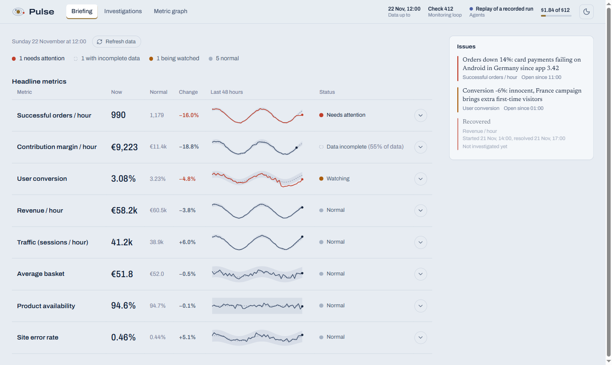
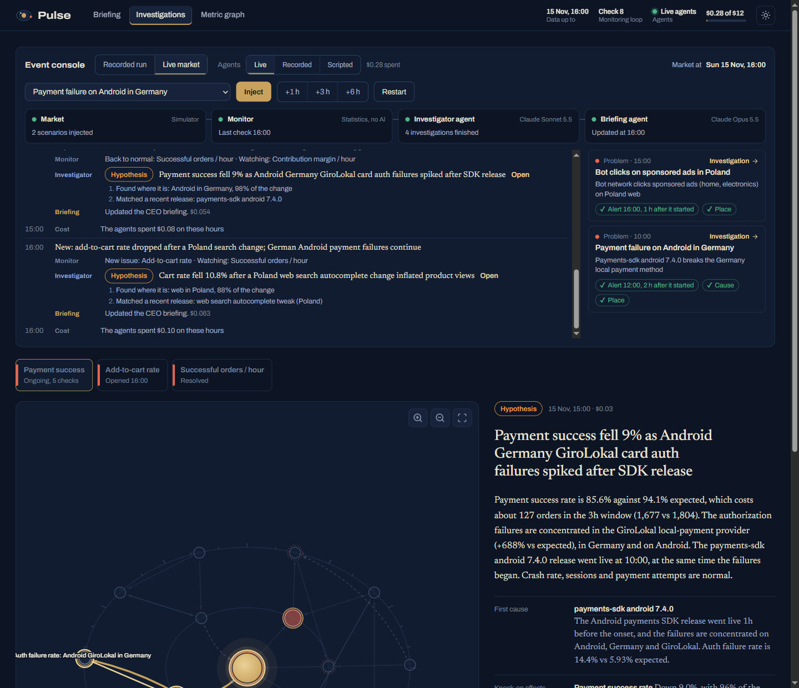
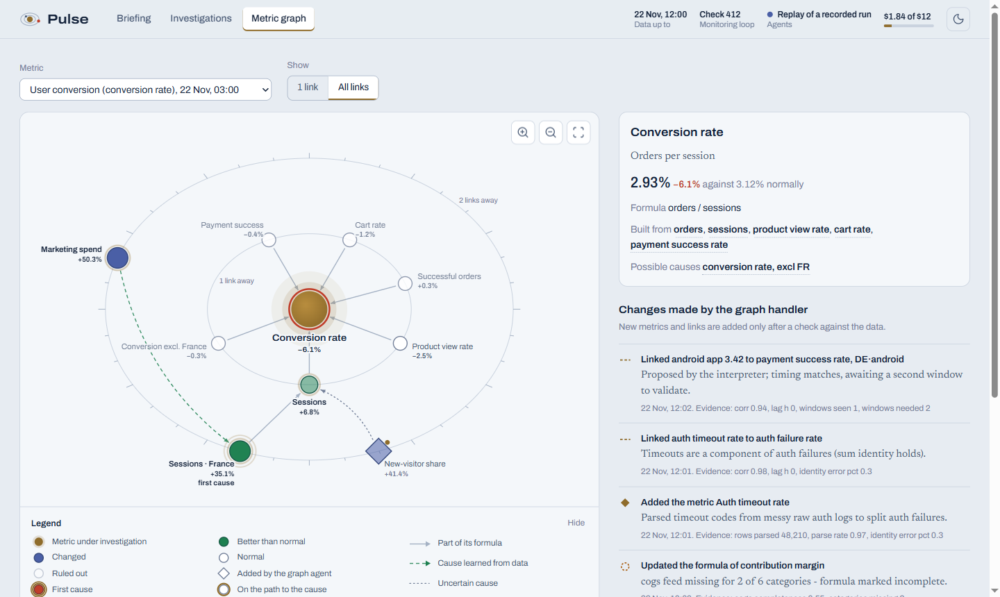

# Pulse: the eyes of a marketplace

**Hackathon entry, track "Eye of the System: Fully Agentic Monitoring"** (Almedia track, HackLab Berlin).
Brief: [`docs/HACKATHON_BRIEF.md`](docs/HACKATHON_BRIEF.md).

Pulse watches a simulated Amazon-like marketplace with nobody asking questions. Every hour it checks the business
against a seasonal normal, opens an issue when something really moves, sends an investigator agent down a typed
graph of metrics to the first cause, and writes a short CEO briefing with the evidence, the business impact and what
is still uncertain. New metrics can be dropped in as plain text, SQL or a half-filled form: an agent works out where
they belong in the graph, and code validates them against the data before they are used.



## What happens in one hour

1. **Extend the graph.** New metric definitions in the inbox go to the *graph handler* agent (Claude Sonnet 5.5). It
   turns the messy input into a definition, links it to existing metrics, and code accepts or rejects every link.
2. **Monitor.** Statistics (no AI) compare the 9 CEO KPIs, plus any metric the CEO pinned, against a seasonal
   baseline. They take data completeness and planned events (campaigns, maintenance, TV football) into account.
3. **Track issues.** Each issue is opened, persisting, escalated or resolved. An issue that continues is not reported
   again.
4. **Investigate.** For a new or escalated issue, the *investigator* agent (Claude Sonnet 5.5) walks the graph with
   tools. It narrows the move to a segment, tests recent releases and rival explanations, and stops when the evidence
   is sufficient.
5. **Brief.** The *briefing* agent (Claude Opus 5.5) rewrites the CEO briefing only when something material changed.
   Otherwise a template updates the numbers for free.

`pulse watch` runs this loop on its own, hour after hour. The web UI only reads what the loop wrote.

## How Pulse meets the judging criteria

| Criterion | What Pulse does | Where |
|---|---|---|
| **40% Metric graph + automatic extension** | A typed graph: arithmetic **formula** edges (conversion rate = orders / sessions), **breakdown** edges (by country, platform, category) and **cause** edges with sign, lag and status (validated, ambiguous, proposed, rejected). New metrics arrive as prose, SQL or YAML; the graph handler places them, duplicates become aliases or are marked ambiguous, formulas must reconcile with the data, and cause links need a lagged correlation on deseasonalised data. Accepted changes are logged and survive restarts. | `pulse/graph_api.py`, `pulse/graph_handler.py`, `pulse/inbox_examples/` |
| **40% Autonomous monitoring + investigation** | Seasonal baselines, robust z-scores, polarity (a drop in errors is good), completeness checks (incomplete data becomes a data issue, not an alert), planned events (an expected move becomes "watching"), slow-drift escalation. The investigator separates first causes from downstream symptoms using each metric's own vs inherited share of the move, quantifies each segment's contribution, keeps a ledger of competing hypotheses, and labels the result **supported** or **hypothesis**. | `pulse/monitor.py`, `pulse/incidents.py`, `pulse/interpreter.py` |
| **20% Working demo** | A live event console: start a simulated market, inject a fault, an innocent change or a data problem, run hours, and watch the agents work. Each scenario is scored against the truth Pulse was not told. | `pulse/web/` |

## The algorithm

Design rule: **statistics decide *whether*, the graph decides *where*, the LLM chooses the next step and tells the
story, and code (never the LLM) accepts graph changes.** Every agent also has a deterministic mock policy, so the
whole system runs and is tested without an API key.

**What to monitor.** The 9 CEO KPIs in `pulse/kpis.yaml`, plus metrics the CEO pins in the UI, minus those the CEO
untracks (they stay in the graph as background metrics). Each hour gets a seasonal expected value and a robust
z-score. Severity depends on polarity, whether a planned event explains the move, and whether the data is complete.
A metric that keeps drifting for 6 hours escalates even if no single hour is extreme.

**Which connections to follow.** The investigator starts at the KPI and follows the formula inputs that carry the
change, downwards, as long as they move in the same direction. At each node it reads the node's *own* share of the
move: a node whose move is mostly inherited from its inputs is a symptom. It shows the top 4 neighbours per hop and
can expand further.

**Which groups to examine.** At the deepest moving node it localises the change by country, platform and category,
and checks that the rest (the control group) is normal. Then it tests cause edges into that node (the cause must move
with the edge's sign) and the change log: releases, campaigns, calendar events near the onset.

**When the evidence is sufficient.** The investigator stops when the explanation covers at least 70% of the KPI's
change **and** at least 2 independent types of evidence agree (timing match, segment localisation, a normal
control group, own-change share, a moving cause metric). Then it is **supported**; with less it is a
**hypothesis**. If the data on the path is under 90% complete it stops with **data issue**. It has a budget of about
8 tool calls, and must test at least one rival explanation before concluding.

**Adapting.** Resolved issues go into a case memory that later investigations recall as hypotheses. Links the
investigator proposes are kept as "proposed" until a second window confirms them. The CEO's pin and untrack choices
change what is monitored on the next check.



## Quick start

Python 3.11. Windows PowerShell shown. On macOS or Linux use `python3 -m venv .venv` and `.venv/bin/python` instead
of `.\.venv\Scripts\python.exe`.

```powershell
python -m venv .venv
.\.venv\Scripts\python.exe -m pip install -r requirements.txt
copy .env.example .env      # optional: add ANTHROPIC_API_KEY for live agents; without it everything runs scripted
```

**Fastest look (no data needed):** bundled fixtures from a recorded run, on http://127.0.0.1:8765
```powershell
.\.venv\Scripts\python.exe -m pulse.web --demo
```

**The full system:** generate the marketplace data, let Pulse monitor the 40-hour demo window, then open the UI.
```powershell
.\.venv\Scripts\python.exe -m marketplace.run                       # 1-21 Nov 2026, all scenarios -> data/eye/ (~1 min, seeded)
.\.venv\Scripts\python.exe -m pulse replay --start "2026-11-17 12:00" --end "2026-11-19 03:00"   # demo window
.\.venv\Scripts\python.exe -m pulse.web                             # UI with the event console
```

## Demo script (about 5 minutes)

Open **Investigations**. The **Event console** is at the top.

1. **Live market** -> **Start live market**: a quiet history up to Sunday 15 Nov, 09:00 (about 30 s).
2. **A fault:** pick *Payment failure on Android in Germany*, click **Inject**, then **+3 h**. The pipeline strip
   lights up the monitor, the investigator agent and the briefing agent in turn. The investigation below names the
   payments SDK release, Android and Germany. The scenario card scores it: alert time, cause named, place named.
3. **An innocent change:** inject *France Black Week teaser campaign* and run **+3 h**. Conversion dips, but Pulse
   marks it as expected (watching) and raises no alert. Its card says so.
4. **A new metric:** copy `pulse/inbox_examples/checkout_errors_prose.txt` (a plain-English request with no table or
   formula) into `.pulse_live/inbox/` and run **+1 h**. The graph handler finds the data, defines the metric and
   links it. It appears under **Changes made by the graph handler** on the **Metric graph** page.
5. Back on **Briefing**: the CEO view with the issues, and a row per metric with its 48-hour chart.



## Results

**Scorecard** (`pulse.evaluate`, 8-21 Nov, scripted agents, scored against the simulator's ground truth, last
measured 22 Nov 2026):

| | |
|---|---|
| Faults detected | 8 / 14 |
| Root-cause change named | 6 / 11 |
| Affected segment named | 6 / 12 |
| Innocent changes alerted (lower is better) | 0 / 6 |
| Data issues recognised | 2 / 2 |
| False alarms | 0 |

**With live Claude agents** (22 Nov 2026): the 40-hour demo window costs about $0.50 and tells the same story as
the scripted run. The live investigator names the GiroLokal provider, Android and Germany for the payment fault, and
rates it as a hypothesis.

**Known limits.** Faults that move only one segment and never the total KPI are missed (6 of the 14), because
detection runs on headline totals. Segment-level detection would catch them. Data is hourly, so detection is at best
one hour after the onset.

## Running Pulse

```powershell
# monitoring loop (scripted agents by default)
.\.venv\Scripts\python.exe -m pulse tick --next
.\.venv\Scripts\python.exe -m pulse watch --interval-s 15 --start "2026-11-17 12:00"   # always-on loop, 1 hour per 15 s
.\.venv\Scripts\python.exe -m pulse recheck    # apply pinned / untracked metrics to the last checked hour
.\.venv\Scripts\python.exe -m pulse status
.\.venv\Scripts\python.exe -m pulse reset

# UI on http://127.0.0.1:8765
.\.venv\Scripts\python.exe -m pulse.web --state .pulse       # a given state folder
.\.venv\Scripts\python.exe -m pulse.web --demo-live          # animated investigation from the fixtures

# checks
.\.venv\Scripts\python.exe -m pytest tests/pulse -q    # 63 tests, incl. a check that this README matches the code
.\.venv\Scripts\python.exe -m pulse.evaluate           # scorecard against the simulator's ground truth (~90 s)
```

### Always-on loop
`pulse watch` runs the monitoring by itself: every `--interval-s` seconds it checks the next hour of data (on the
recorded data it steps the clock one hour at a time, from `--start` or from the last check), investigates what moved
and writes the briefing, with nobody clicking. A failing check is logged and tried again, and only one loop runs per
state folder. The top bar of the UI shows the loop as it works (**Checking 15:00 now**, **Next check in 12 s**,
**Not watching**).

### Live agents
The agents run scripted (free, no API calls) unless `PULSE_LLM` is set; `.env.example` lists the settings.
- `live`: real Claude calls. Opus 5.5 writes the briefing, Sonnet 5.5 investigates and adds new metrics. Each agent run
  and the total are capped, and every answer is recorded in `<state>/cassettes/`.
- `replay`: the recorded answers again with the real tools, for free. Anything not recorded falls back to scripted.

While an issue stays open the briefing agent can ask for a fresh investigation; it runs at most every 3 checks.
`pulse reset` keeps the recorded answers, so a live run can be replayed in the same state folder.
```powershell
$env:PULSE_LLM = "live"; .\.venv\Scripts\python.exe -m pulse replay --start "2026-11-17 12:00" --end "2026-11-19 03:00"
$env:PULSE_LLM = "replay"; .\.venv\Scripts\python.exe -m pulse watch --interval-s 15 --start "2026-11-17 12:00"
```

### Event console
**Live market** runs a separate simulated market, with its data in `data/live/` and Pulse's state in `.pulse_live/`,
so the recorded run and `data/eye/` are never touched.
- **Start live market**: a quiet history from 1 Nov up to Sunday 15 Nov, 09:00 (about 30 s).
- **Inject**: one of 8 faults, 4 planned changes or 2 data problems, live from the next market hour.
- **+1 h / +3 h / +6 h**: the market runs, then Pulse checks each new hour and investigates what moved (about 15 s for
  3 hours with scripted agents, a minute or two with live ones).
- **Agents**: **Live** (real Claude calls, capped, the cost shows next to it), **Recorded** (answers recorded in an
  earlier live run, free) or **Scripted** (no AI). It starts as the server's `PULSE_LLM`.

While Pulse works, the console shows it as it happens: a strip with the market, the monitor, the investigator agent
and the briefing agent (the one working now is lit), and a log with one block per market hour: one line for what the
monitor saw change, each investigation's conclusion with its main steps, and the briefing. The investigation below
follows the agent: its graph highlights the metrics that matter (a running investigation adds them as it goes). Each
injected scenario gets a card with what really changed (Pulse is not told) and what Pulse found: when the alert came,
whether the cause and the place were named, or, for a planned change or a data problem, that no alert was raised. On
the briefing, the metrics and issues that changed at the last check are marked.

**Recorded run** switches the whole UI back to the state the server was started with. While the live market is shown,
the briefing's **Refresh data** button runs the market one hour.

### Pin and untrack metrics
The CEO decides which metrics are on the briefing.
- **Pin**: click a metric on the Investigations graph or the Metric graph, then **Pin to the briefing**. It is then
  monitored like the 9 CEO KPIs: its own row with the 48-hour chart, seasonal normal range, alerts, issues and
  investigations. The row appears in about 15 seconds, for the hour already checked.
- **Untrack**: open a row on the briefing and click **Untrack**. The metric becomes a background metric: no alerts or
  issues of its own (an open issue is closed as no longer tracked), but it stays in the graph and investigations of
  the other metrics still look at it. **Restore** in the background metrics line under the table brings it back.

The choices are saved in `choices.json` at the repo root (not committed). The recorded run and the live market use the
same choices, and they survive restarts and `pulse reset`. The scorecard (`pulse.evaluate`) ignores them.

## The simulator

There is no provided dataset, so `marketplace/` simulates one: hourly data for sessions, search, the For You feed,
carts, checkout, payments by provider, advertising and budget pacing, inventory and supplier deliveries, sellers,
margin and a user panel, across countries and platforms. It injects faults, innocent changes and data problems, and
writes the ground truth to `data/eye/injected.json` (Pulse never reads it; only the scorecard does). Data guide:
[`docs/DATA_OVERVIEW.md`](docs/DATA_OVERVIEW.md).

```powershell
.\.venv\Scripts\python.exe -m marketplace.run --out data/eye_test   # write somewhere else
.\.venv\Scripts\python.exe -m marketplace.user_report --country DE  # funnel and top products from the user panel

# live mode: the marketplace advances one simulated hour per tick, Pulse follows with `pulse watch`
.\.venv\Scripts\python.exe -m marketplace.live start                # quiet history 1-14 Nov, clock at 15 Nov 00:00
.\.venv\Scripts\python.exe -m marketplace.live loop --seconds 4
.\.venv\Scripts\python.exe -m marketplace.live inject payment_failure
.\.venv\Scripts\python.exe -m marketplace.live list                 # all scenarios
```
`marketplace.run` and `marketplace.live` rewrite `data/eye/`. Run `marketplace.run` again to restore the full 3-week
dataset that the demo window and the scorecard use. The UI's **Refresh data** button checks the next hour of data; in
live mode, once Pulse has seen every hour, it first asks the simulator for a new one (about 30 s).

## Repository

| Path | What it is |
|---|---|
| `pulse/` | The monitor: loop, statistics, incidents, the three agents, graph API, web UI. Component map: [`pulse/MAP.md`](pulse/MAP.md) |
| `marketplace/` | The marketplace simulator, with injected scenarios and ground truth |
| `argus/` | Metric library used by Pulse: warehouse (DuckDB), metric registry, metric engine, metric graph, statistics |
| `.argus/` | The learned graph base `argus` loads (added metrics, aliases, identities, learned causes) |
| `tests/pulse/` | Tests, all offline (the live Claude path is tested against a fake client) |
| `docs/` | The hackathon brief and the simulator's data guides |

Built with Python, DuckDB, NetworkX, statsmodels, the Anthropic SDK (all Claude calls go through `pulse/llm.py`, with
cost caps and recorded answers) and a dependency-free web UI. Developed with Claude Code.

## License
MIT, see [LICENSE](LICENSE).
